<div align="center">


# HRI Insight Bridge

**경제 보고서 AI 요약·질의응답 및 관리자 모니터링 서비스**

경제 분석 보고서(PDF)를 올리면 **근거 쪽수와 함께 요약·답변**하고,<br/>
여러 보고서의 경제 지표를 **한 표로 비교**해 주는 RAG 기반 웹 서비스입니다.

<br/>


현대 AI 서비스 개발자 과정 · 1차 프로젝트 **4조 Insight Bridge**<br/>
2026.10.21 ~ 2026.11.02

[시연](#시연) · [주요 기능](#주요-기능) · [아키텍처](#시스템-아키텍처) · [시작하기](#시작하기) · [팀 소개](#팀-소개)

</div>


---

## 목차

1. [한눈에 보기](#한눈에-보기)
2. [프로젝트 개요](#프로젝트-개요)
3. [시연](#시연)
4. [주요 기능](#주요-기능)
5. [시스템 아키텍처](#시스템-아키텍처)
6. [기술 스택](#기술-스택)
7. [DB 구조](#db-구조)
8. [문제 해결 사례](#문제-해결-사례)
9. [검증 결과](#검증-결과)
10. [시작하기](#시작하기)
11. [폴더 구조](#폴더-구조)
12. [팀 소개](#팀-소개)
13. [프로젝트 진행](#프로젝트-진행)
14. [자체 평가와 회고](#자체-평가와-회고)

---

## 한눈에 보기

<div align="center">
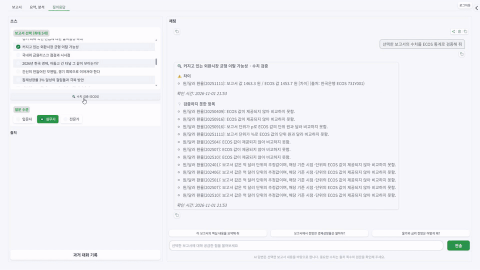
<br/><sub>핵심 기능: 여러 보고서의 경제 지표를 뽑아 차트·표·ECOS 공식 통계로 비교</sub>
</div>

<br/>

서비스 이름 **HRI**는 세 가지 핵심 가치의 머리글자입니다.

| | 가치 | 이렇게 구현했습니다 |
|:-:|---|---|
| **H** | **Highlight** · 필요한 것만 요약 | 3줄 요약, 섹션별 요약(쪽 범위 표시), 여러 보고서 병합 요약 |
| **R** | **Refresh** · 최신 지표 반영 | 한국은행 ECOS 통계로 보고서 수치 검증, 한국수출입은행 환율 조회 |
| **I** | **Integrate** · 여러 보고서를 한눈에 | 본문·표·차트에서 지표를 추출해 보고서 간 비교표와 차트 생성 |

> **근거 우선 원칙**: 모든 답변에 보고서 이름과 쪽수를 붙이고, 근거를 찾지 못하면 LLM을 호출하지 않고 **"자료에 없습니다"** 라고 답합니다.

---

## 프로젝트 개요

### 왜 만들었나

경제 보고서를 읽고 활용하는 사람들이 겪는 어려움에서 출발했습니다.

| 문제 | 상황 |
|---|---|
| **분량** | 실제로 사용한 현대경제연구원 보고서 37편은 12~62쪽, 평균 약 25쪽입니다. 한 편을 파악하는 데에도 시간이 오래 걸립니다. |
| **용어 장벽** | 익숙하지 않은 경제 용어에서 읽기가 막힙니다. |
| **비교의 번거로움** | 같은 지표도 기관마다 전망값이 다르고, 보고서마다 흩어진 수치를 직접 표로 만들어야 합니다. |
| **근거 없는 답** | 일반 챗봇은 출처 없이 답하고, 학습 시점의 과거 수치에 머물러 있습니다. |

### 누구를 위한 서비스인가

| 타깃 사용자 | 필요한 것 |
|---|---|
| **기획·전략팀 실무자** | 사업 계획·전략 보고서에 넣을 경제 전망과 근거 수치를 출처까지 빠르게 |
| **신입 애널리스트 · 취준생** | 여러 기관 보고서의 핵심 결론과 수치를 빠르게 파악하고 학습 |
| **일반 직장인** | 3줄 요약과 출처 쪽수로 핵심만 빠르게 확인 |

### 실무자 인터뷰를 반영했습니다

| 인터뷰에서 나온 의견 | 반영한 내용 |
|---|---|
| "여러 보고서에서 필요한 부분만 발췌하는 일이 가장 번거롭다. 하나만 먼저 쓴다면 **여러 보고서 비교**를 쓰고 싶다." | 지표 추출·비교표를 **가장 먼저** 구현한 핵심 기능으로 설정 |
| "제공되는 자료의 출처와 전문성이 고려되는지 의문이다." | 지표·답변마다 출처 보고서와 쪽수를 표시하고, 근거가 없으면 "자료에 없습니다"로 응답 |
| "단순 데이터 나열보다 전망·판단 중심이면 좋겠다." | ECOS 최신 통계를 조회해 보고서 작성 시점의 예측치와 비교 |

### 기존 서비스와 다른 점

| | 차별점 | 설명 |
|:-:|---|---|
| ⭐ | **여러 보고서 지표 추출·비교표** | 본문·표·차트에서 지표를 자동으로 뽑아 이름을 통일하고 보고서 간 비교표·차트로 정리 |
| ① | **근거 우선** | 답변마다 보고서·쪽수 표시, 근거가 없으면 LLM 호출 없이 "자료에 없습니다" |
| ② | **표·차트 복원** | 표는 구조를 보존해 추출하고, 차트 이미지는 OCR과 Vision LLM으로 수치 표로 복원 |
| ③ | **최신 공식 통계 연동** | 에이전트가 ECOS·한국수출입은행 데이터를 조회해 보고서 수치를 검증 |
| ④ | **눈높이 맞춤 설명** | 입문자·실무자·전문가 수준에 맞춰 용어 난이도와 답변 구성을 조절 |

---

## 시연

> 전체 시연 영상(5분 44초): [hri_video_demo_v5.mp4](https://drive.google.com/file/d/1A9ToBdDFVfQynrooGCXO7a_pqgLcwMgv/view?usp=drivesdk)
> <!-- TODO: 팀 내부 Drive 링크입니다. 포트폴리오로 공개할 때는 YouTube 등 공개 링크로 교체하세요. -->

아래 GIF는 시연 영상을 기능별로 나눈 것입니다. 각 항목을 눌러 펼쳐 보세요.

<details open>
<summary><b>① 회원가입 · 로그인</b></summary>
<br/>

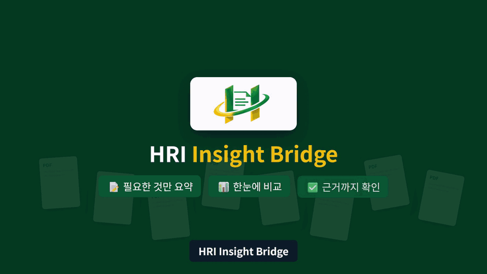

- 아이디·비밀번호·이름 세 칸만으로 가입하고, 같은 화면에서 바로 로그인합니다.
- 가입한 계정은 항상 일반 사용자 권한입니다. 로그인하면 역할에 따라 첫 화면이 달라집니다(일반 사용자는 보고서 목록, 관리자는 대시보드).

</details>

<details>
<summary><b>② 보고서 목록 · 검색</b></summary>
<br/>

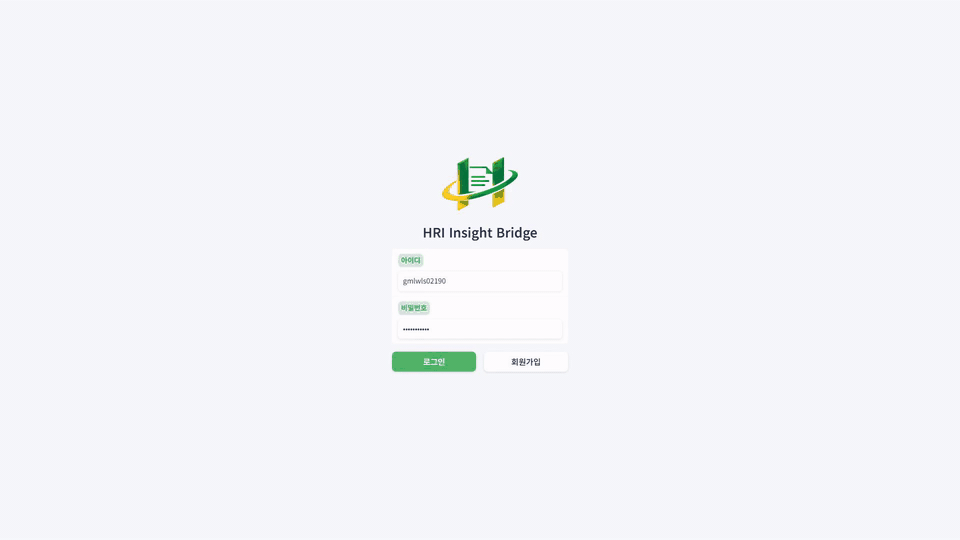

- 로그인 후 첫 화면은 보고서 라이브러리입니다. 제목·발행기관·발행일·청크 수를 표로 보여 줍니다.
- 검색칸 하나로 제목과 발행기관을 함께 찾고, 고른 보고서를 들고 **요약 보기** 또는 **질의응답으로 이동**합니다.

</details>

<details>
<summary><b>③ PDF 업로드</b></summary>
<br/>

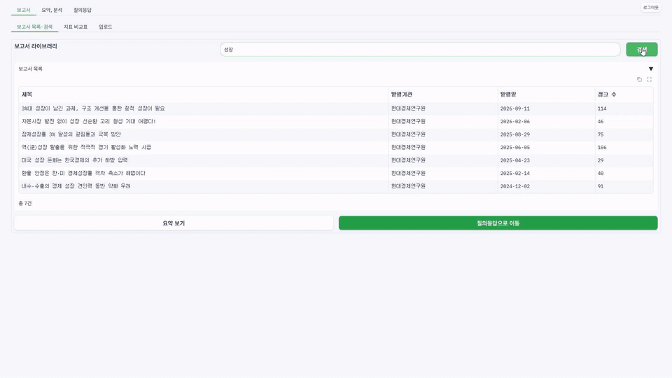

- PDF를 끌어다 놓거나 눌러서 올립니다. 여러 개를 한 번에 올릴 수 있습니다.
- 업로드하면 형식·용량·쪽수·암호화를 검증한 뒤 본문·표·차트를 병렬로 추출해 MySQL과 벡터 DB에 저장합니다.

</details>

<details>
<summary><b>④ 요약 · 분석 (3줄 요약 / 섹션별 요약 / 병합)</b></summary>
<br/>

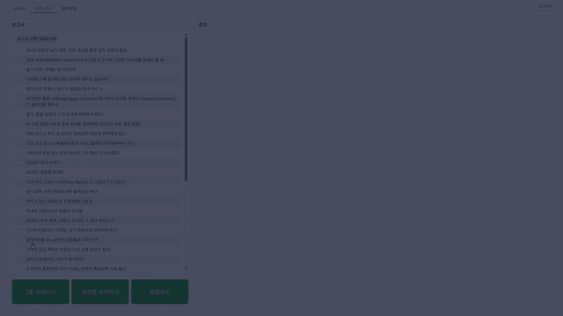

- **3줄 요약**: 핵심 주장 → 근거 수치 → 시사점 순서의 세 문장입니다.
- **섹션별 요약**: 장 단위로 요약하고 장 제목 옆에 쪽 범위를 붙입니다. 쪽 번호는 AI가 아닌 시스템이 원문 위치에서 가져옵니다.
- **병합하기**: 보고서 2~5개를 대상 보고서 → 공통 의견 → 차이점 → 종합 결론 순서로 정리하고 문장마다 근거 보고서를 표시합니다.

</details>

<details>
<summary><b>⑤ 질의응답 · 출처 · "자료에 없습니다"</b></summary>
<br/>

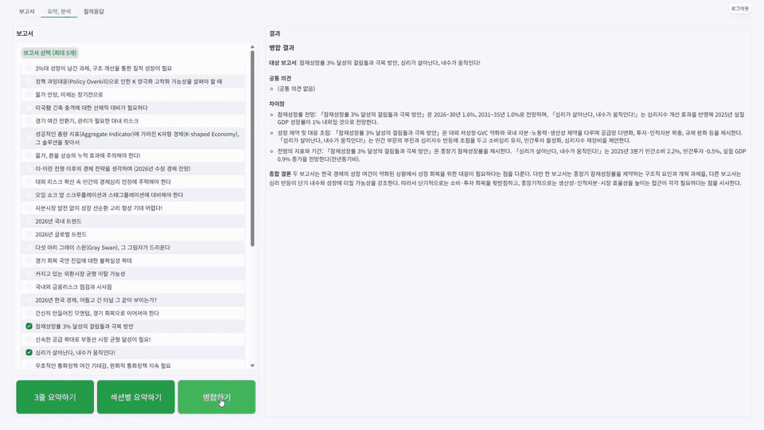

- 근거로 쓸 보고서와 질문 수준(입문자·실무자·전문가)을 고르고 자연어로 질문합니다.
- 답변은 스트리밍으로 나오고, 끝에 근거 보고서와 쪽수가 붙습니다. 👍/👎 피드백은 관리자 통계로 이어집니다.
- 보고서에 없는 내용을 물으면 지어내지 않고 **"자료에 없습니다"** 라고 답합니다.

</details>

<details>
<summary><b>⑥ 용어 검색</b></summary>
<br/>

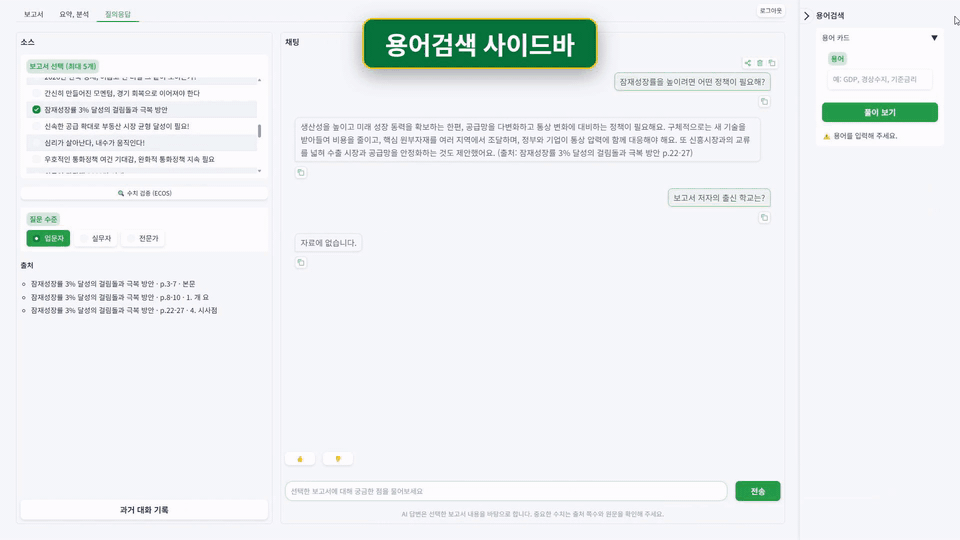

- 질의응답 화면 오른쪽 사이드바에서 대화를 떠나지 않고 용어를 찾습니다.
- 쉬운 풀이와 ECOS 통계용어 사전의 원문 정의를 함께 보여 줍니다.

</details>

<details>
<summary><b>⑦ 과거 대화 이어가기</b></summary>
<br/>

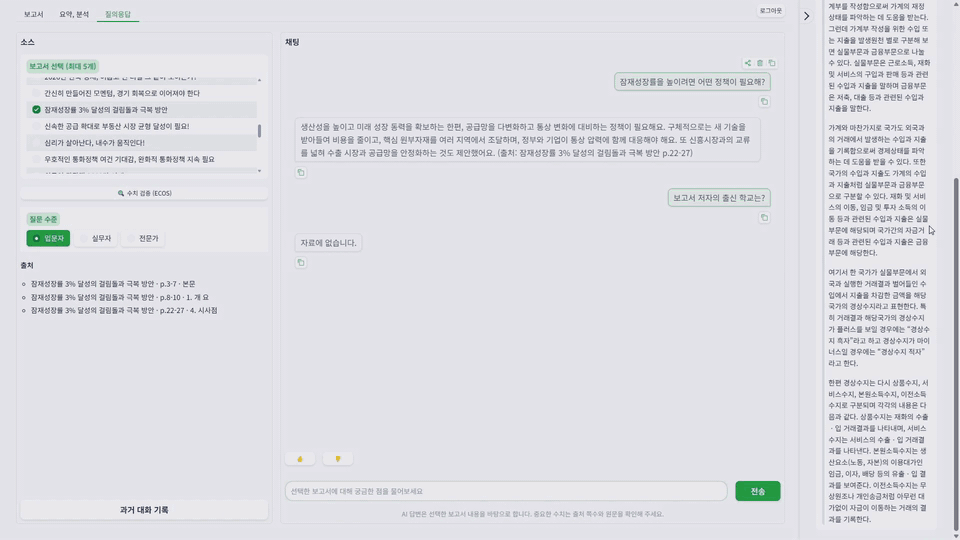

- 대화마다 마지막 시각·첫 질문·질문 수를 보고 골라서 **대화 이어가기**를 누르면 이전 대화가 그대로 복원됩니다.
- 기록은 계정별로 분리되고, 개인정보는 가려진 채로 표시됩니다.

</details>

<details>
<summary><b>⑧ 수치 검증 (ECOS)</b></summary>
<br/>

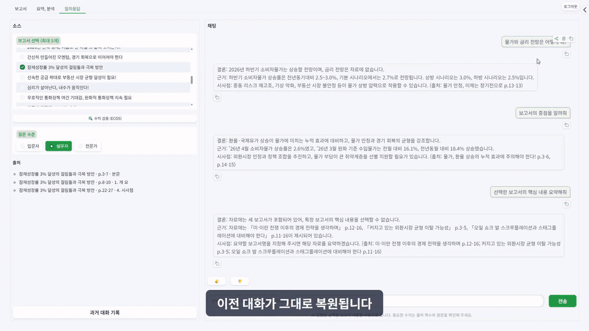

- 고른 보고서의 수치를 한국은행 ECOS 공식 통계와 자동으로 대조합니다.
- 결과를 일치·근사 / 차이 / ECOS로 보완한 항목으로 나누고, 비교하지 못한 항목도 이유와 함께 알려 줍니다.

</details>

<details>
<summary><b>⑨ 지표 비교표 · 차트 ⭐ 핵심 기능</b></summary>
<br/>


- 보고서 2~5개를 골라 지표를 추출하면 **비교 차트 → 비교 표 → ECOS 데이터** 순으로 깊이를 조절해 볼 수 있습니다.
- 두 개 이상의 보고서에 함께 나온 지표만 그리고, 단위가 다른 지표는 차트를 나눠 그립니다.
- 비교 표의 값마다 출처 쪽수를 붙이고, 마지막 열에 보고서 간 차이(최대-최소)를 보여 줍니다.

</details>

<details>
<summary><b>⑩ 관리자 대시보드</b></summary>
<br/>

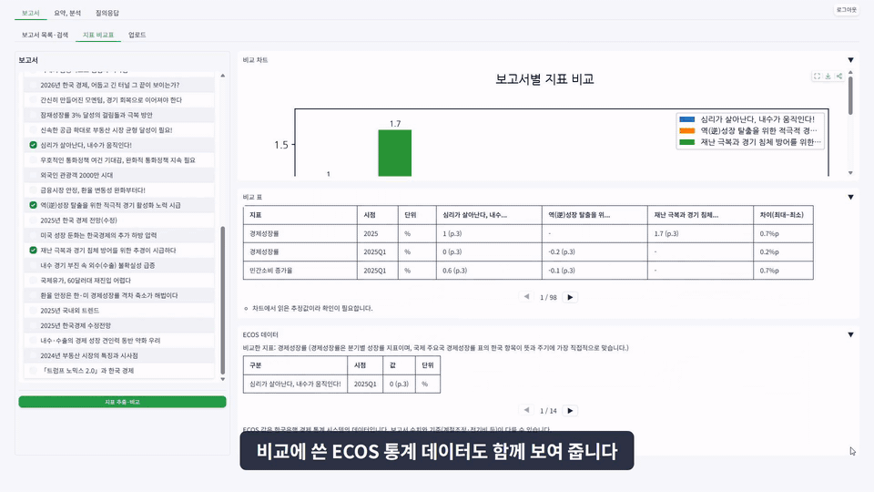

- **보고서 관리**: 보고서 업로드와 전체 목록을 확인합니다.
- **통계**: 일별 질문 수와 응답 시간, 질문 TOP 10, 페르소나·처리 방식별 비율, 답변 품질(피드백, "자료에 없습니다" 비율), 기능별 토큰 사용량과 원화 비용을 봅니다.
- **시스템 에러 로그**: 오류가 자동으로 기록되며 최근 순으로 확인합니다.

</details>

---

## 주요 기능

### 설계 원칙

화면을 만들 때 아래 네 가지를 판단 기준으로 삼았습니다.

| | 원칙 | 내용 | 적용된 곳 |
|:-:|---|---|---|
| 01 | **근거가 보이는 AI** | 답변·요약·비교표에 보고서 이름과 쪽수를 붙이고, 근거가 없으면 지어내지 않습니다. | 질의응답 출처, 섹션 요약 쪽 범위, 비교표 쪽수, 수치 검증 |
| 02 | **보고서에서 시작하는 흐름** | 모든 기능은 "어떤 보고서를 볼지" 고르는 데서 시작하고, 선택 방식(최대 5개 체크박스)은 어느 화면에서나 같습니다. | 요약 보기 · 질의응답으로 이동 버튼, 공통 보고서 선택 |
| 03 | **사용자 눈높이에 맞춘 설명** | 입문자·실무자·전문가에 맞춰 용어 난이도와 답변 구성을 바꿉니다. | 질문 수준, 용어 검색 |
| 04 | **흐름을 끊지 않는 도구** | 수치 검증·용어 검색·대화 기록은 채팅 안이나 옆에서 열리고, 오래 걸리는 작업은 경과 시간과 단계를 보여 줍니다. | 수치 검증 메시지, 용어 사이드바, 진행 표시 |

### 화면 구성

| 메뉴 | 화면 | 주요 기능 | 권한 |
|---|---|---|---|
| 보고서 | 목록·검색 | 보고서 검색, 요약·질의응답으로 바로 이동 | 사용자 |
| 보고서 | 지표 비교표 | 보고서 2~5개의 경제 지표를 차트·표·ECOS 데이터로 비교 | 사용자 |
| 보고서 | 업로드 | 보고서 PDF 업로드(다중 업로드, 중복 업로드 방지) | 사용자 |
| 요약, 분석 | 요약·분석 | 3줄 요약, 섹션별 요약, 여러 보고서 병합 | 사용자 |
| 질의응답 | 채팅 | 보고서 근거 질의응답, 질문 수준, 추천 질문, 출처, 피드백 | 사용자 |
| 질의응답 | 수치 검증 · 용어 검색 · 과거 대화 | ECOS 대조, 용어 사이드바, 대화 이어가기 | 사용자 |
| 관리자 | 보고서 관리 · 통계 · 에러 로그 | 업로드, 사용 현황·답변 품질·비용, 오류 기록 | 관리자 |

### 사용자 흐름

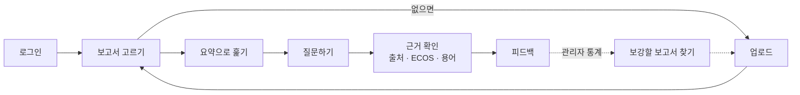

관리자는 통계에서 "자료에 없습니다" 비율과 근거를 찾지 못한 질문을 보고 부족한 보고서를 올린 뒤, 비율이 줄었는지 다시 확인하는 순환 구조로 운영합니다.

---

## 시스템 아키텍처

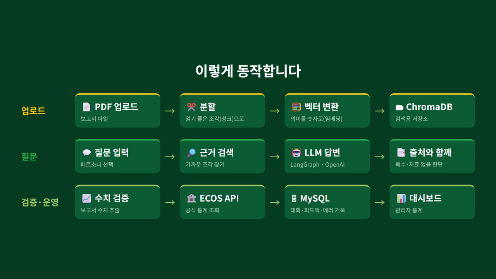

### 4계층 구조

| 계층 | 역할 | 구성 |
|---|---|---|
| ① 화면 | 사용자가 보는 웹 화면 | Gradio (`hri/view`) |
| ② 기능 처리 | 요청을 받아 업무 흐름 실행 | Service (`hri/service`) + LangGraph 그래프 4종 (`hri/graph`) |
| ③ AI · 외부 데이터 | 답변 생성과 최신 정보 | OpenAI (LLM·Vision·임베딩), ECOS, 한국수출입은행 |
| ④ 저장소 | 정보 보관 | MySQL (보고서·지표·기록·비용), ChromaDB (검색용 벡터 색인) |

### LangGraph 그래프 4종

| 그래프 | 파일 | 역할 |
|---|---|---|
| **ingest** | `hri/graph/ingest_graph.py` | PDF 검증 → 텍스트·표·차트 병렬 추출 → 섹션·청크 분할 → 표·차트 요약 → 저장 |
| **qa** | `hri/graph/qa_graph.py` | 질문 분류 → 질문 확장 → 하이브리드 검색 → 관련도 판단 → 답변 생성 → 출처·기록 |
| **summary** | `hri/graph/summary_graph.py` | 3줄 요약, 섹션별 요약, 여러 보고서 병합 |
| **agent** | `hri/graph/agent_graph.py` | Tool Calling 에이전트: 요약·검증·병합·ECOS 조회 도구를 골라 실행(반복 횟수 제한) |

### RAG 파이프라인

**업로드 흐름**

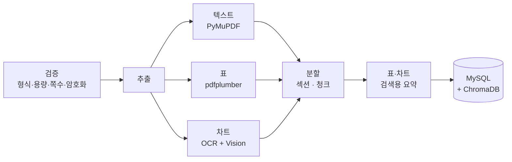

**질의 흐름** (`qa_graph`)

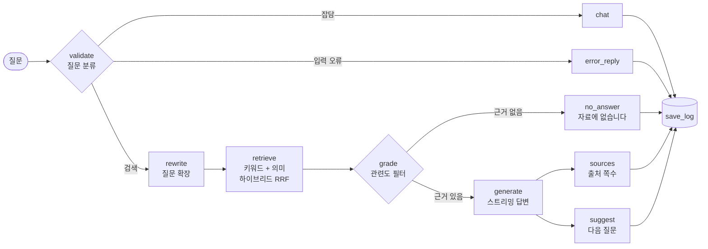

**설계 포인트**

- **근거 없음 규칙**: 의미 검색 결과가 0건이면 키워드 결과가 있어도 빈 결과로 처리하고, LLM 호출 없이 "자료에 없습니다"로 답합니다.
- **검색용과 답변용 분리**: 표·차트는 요약문으로 검색하고, 답변에는 원본 표를 사용합니다.
- **큰 단락 · 작은 조각**: 작은 청크로 찾고, 답변 근거로는 그 청크가 속한 섹션 원문을 사용합니다.

### 프롬프트 설계

| 갈래 | 기법 | 내용 |
|---|---|---|
| 답변 수준 맞춤 | System 역할 + Few-shot | 입문자·실무자·전문가별 모범 답안으로 말투와 난이도를 맞춤 |
| 정해진 형식 | CoT + 구조화 출력(Pydantic) | 3줄 요약(주장 → 근거 → 시사점), 지표 추출 결과를 바로 DB에 저장 |
| 근거 기반 답변 | 구분자(`###`) + 규칙 | `[자료]`만 근거로 답하고 없으면 "자료에 없습니다" |
| 도구 사용 에이전트 | Tool Calling | ECOS 통계·환율 조회 도구를 AI가 골라 호출하고 결과를 보고 다시 판단 |

모든 LLM 호출의 토큰 사용량을 `llm_usage` 테이블에 기록해 관리자 대시보드에서 기능별 원화 비용으로 보여 줍니다.

> 자세한 내용: [`docs/project_structure.md`](docs/project_structure.md) · [`docs/prompt_design.md`](docs/prompt_design.md) · [`docs/qa_design.md`](docs/qa_design.md)

---

## 기술 스택

| 분류 | 기술 |
|---|---|
| **Language** | Python 3.11 |
| **LLM · Framework** | OpenAI API (`gpt-6-luna`, `text-embedding-3-large`), LangChain 1.4, LangGraph 1.2, Pydantic v2 |
| **Vector DB · RDB** | ChromaDB 1.5, MySQL 8.0 (11개 테이블, PyMySQL) |
| **문서 처리** | PyMuPDF (텍스트·차트 이미지), pdfplumber (표), EasyOCR (차트 수치 대조), pypdf |
| **외부 API** | 한국은행 ECOS (경제통계·통계용어), 한국수출입은행 (환율) |
| **UI · 시각화** | Gradio 6.30, Matplotlib |
| **테스트** | pytest |
| **협업** | Git · GitHub (Issue · PR · CODEOWNERS), Poetry |

---

## DB 구조

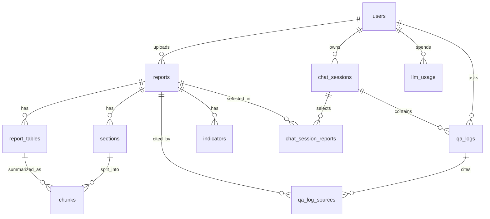

| 영역 | 테이블 | 설명 |
|---|---|---|
| 보고서 내용 | `reports`, `sections`, `chunks`, `report_tables`, `indicators` | 보고서를 섹션(큰 단락)과 청크(작은 조각)로 나눠 저장. 지표는 값·단위·기간·쪽수와 함께 별도 저장해 비교표의 재료로 사용 |
| 대화·기록 | `chat_sessions`, `chat_session_reports`, `qa_logs`, `qa_log_sources` | 질문·답변은 개인정보를 가려 기록하고, 답변에 실제로 쓴 출처를 함께 저장 |
| 회원·사용량 | `users`, `llm_usage` | 회원과 역할, 호출별 토큰 사용량과 비용 |

> 스키마 전체: [`sql/schema.sql`](sql/schema.sql)

---

## 문제 해결 사례

<details open>
<summary><b>1. 차트 검출 오탐: 337개 → 4개</b></summary>

- **문제**: 벡터 그래픽 영역을 차트로 검출했더니 337개 중 실제 차트는 0개였습니다. 표, 글상자, 테두리가 차트로 잡혔습니다.
- **해결**: 실제 보고서 데이터를 분석해 제외 규칙 4개를 정했습니다.
- **결과**: 오탐 337개가 4개로 줄었고, 진짜 벡터 차트 11개는 모두 유지했습니다.

</details>

<details>
<summary><b>2. 표 검수 실패 처리: 버리지 않고 "저장하되 경고"</b></summary>

- **문제**: 구조 검수에서 걸린 표를 버리면 294개 중 137개(약 47%)가 검색에서 빠졌습니다.
- **해결**: 검수에 실패한 표도 저장하되 경고를 남기는 방식으로 정했습니다. 신뢰도가 낮은 값은 "검토 필요"로 표시해 사용자가 원문을 확인하게 했습니다.

</details>

<details>
<summary><b>3. "자료에 없습니다" 규칙이 동작하지 않던 문제</b></summary>

- **문제**: 흔한 단어가 키워드(LIKE) 검색에 걸려 보고서 밖 질문에도 검색 결과가 생겼고, 근거 없음 응답이 나오지 않았습니다.
- **해결**: 의미 검색이 0건이면 키워드 결과가 있어도 빈 결과로 처리하도록 바꿨습니다.

</details>

<details>
<summary><b>4. 대시보드 수치 왜곡</b></summary>

- **문제**: 잡담과 오류 응답이 섞여 "자료 없음 비율"이 부풀려졌습니다.
- **해결**: 처리 방식(route)이 `rag`·`no_answer`인 응답만 집계하도록 바꿔 실제 답변 품질을 보여 주게 했습니다.

</details>

---

## 검증 결과

**확인된 결과**

- **실데이터 점검**: 현대경제연구원 보고서 37편에서 표 294개, 차트 875개(캡션 868개)를 검출했습니다.
- **변조 테스트**: 코드를 일부러 망가뜨려 테스트가 잡아내는지 확인했습니다. 차트 21·13·27가지, 표 15가지, 그래프 8가지 변조를 모두 감지했습니다.

**측정 결과** <!-- TODO: 테스트 결과서(WBS 4.1) 값으로 채워 주세요 -->

| 항목 | 결과 | 비고 |
|---|:-:|---|
| 정답 질문 정확도 | `[ ] / 30` | `tests/eval_qa_accuracy.py` |
| 출처 페이지 일치 | `[ ] / 30` | |
| 보고서 밖 질문 → "자료에 없습니다" | `[ ] / 10` | `tests/fixtures/qa_out_of_scope.json` |
| 지표 추출 정확도 | `[ ]` | |
| 관련도 임계값(THRESHOLD) 확정값 | `[ ]` | `tests/eval_threshold.py` |
| 평균 응답 시간 | `[ ] 초` | |

---

## 시작하기

### 1. 준비물

| 항목 | 버전 · 비고 |
|---|---|
| Python | **3.11** (3.12 이상 불가) |
| MySQL | 8.0 이상 |
| OpenAI API 키 | 필수 |
| ECOS API 키 | 지표·환율 패널, 수치 검증용 (한국은행 ECOS) |
| 한국수출입은행 API 키 | 토큰 비용 원화 환산용 (없으면 해당 기능만 제한) |

### 2. 설치

```bash
git clone https://github.com/hyundai-insight-bridge/highlight-refresh-integrate.git
cd highlight-refresh-integrate

python -m venv .venv
# Windows
.venv\Scripts\activate
# macOS / Linux
source .venv/bin/activate

pip install -r requirements.txt
```

설치에는 PyTorch(EasyOCR 의존성)가 포함되어 수 분이 걸립니다. Linux에서는 CUDA 패키지까지 받아 수 GB가 필요할 수 있습니다.
Poetry를 쓰는 경우 `poetry env use 3.11` → `poetry install`로도 같은 환경을 만들 수 있습니다.

### 3. DB 준비 (MySQL)

```sql
CREATE DATABASE hyb_db DEFAULT CHARACTER SET utf8mb4 COLLATE utf8mb4_0900_ai_ci;
```

```bash
mysql -u root -p hyb_db < sql/schema.sql
```

`schema.sql`은 여러 번 실행해도 안전합니다(없는 테이블만 생성).

### 4. 환경 변수

```bash
# Windows (PowerShell)
Copy-Item .env.example .env
# macOS / Linux
cp .env.example .env
```

`.env`에서 최소한 아래 값을 채웁니다. 나머지는 기본값 그대로 두면 됩니다.

| 키 | 설명 |
|---|---|
| `OPENAI_API_KEY` | OpenAI API 키 |
| `ECOS_API_KEY`, `KOREAEXIM_API_KEY` | 외부 지표·환율 API 키 |
| `MYSQL_USER`, `MYSQL_PASSWORD` | 로컬 MySQL 계정 |
| `CHROMA_MODE` | `persistent` 유지 (로컬 폴더 사용) |

### 5. 실행

```bash
python app.py
```

브라우저에서 `http://localhost:7860`에 접속해 **회원가입** 후 로그인합니다.

- 처음 실행하면 Chroma가 비어 있으므로 **보고서(PDF)를 먼저 업로드**해야 요약·질의응답을 사용할 수 있습니다.
- 첫 PDF 처리 시 EasyOCR이 OCR 모델을 내려받기 때문에 인터넷 연결과 약간의 시간이 필요합니다.
- 관리자 화면을 쓰려면 가입한 계정의 역할을 바꿉니다.

  ```sql
  UPDATE users SET role = 'admin' WHERE user_id = '<아이디>';
  ```

---

## 폴더 구조

```text
highlight-refresh-integrate/
├─ app.py                 실행 파일 (hri.view.app.main 호출)
├─ hri/                   애플리케이션 패키지
│  ├─ view/               Gradio 화면 (보고서·요약·질의응답·기록·관리자)
│  ├─ service/            화면 요청 처리 흐름
│  ├─ graph/              LangGraph 그래프 (ingest · qa · summary · agent)
│  ├─ loader/             PDF 텍스트·표·차트 추출
│  ├─ splitter/           섹션·청크 분할
│  ├─ vector_store/       임베딩, Chroma 저장
│  ├─ retriever/          키워드·의미·하이브리드 검색
│  ├─ prompt/             RAG·요약·페르소나 프롬프트
│  ├─ memory/             대화 기록 관리
│  ├─ router/             Tool Calling 도구 목록·에이전트 실행
│  ├─ llm/                LLM 호출·비용 계산
│  ├─ api/                ECOS·환율 외부 API
│  ├─ dao/                MySQL 접근
│  ├─ domain/schemas/     Pydantic 모델
│  ├─ config/ exception/ util/ source/ suggest/
├─ sql/schema.sql         MySQL 스키마
├─ docs/                  설계 문서, 시연 GIF (docs/demo)
└─ assets/                폰트·로고
```

자세한 구조는 [`docs/project_structure.md`](docs/project_structure.md)를 참고하세요.

---

## 팀 소개

<div align="center">

|  |  |  |  |  |  |
|:-:|:-:|:-:|:-:|:-:|:-:|
| **류현수** | **김희진** | **서동안** | **엄정현** | **임세준** | **장유빈** |
| 팀장 | 팀원 | 팀원 | 팀원 | 팀원 | 팀원 |
| 환경 · 협업 · 통합 | 요약 · 업로드 · 에이전트 | 질의응답 · 프롬프트 | 문서 처리 · ECOS | 화면 · 관리자 | RAG 검색 · 지표 비교 |
| [@HyeonsuRyu](https://github.com/HyeonsuRyu) | [@gmlwls02190](https://github.com/gmlwls02190) | [@dongan0718](https://github.com/dongan0718) | [@string2015](https://github.com/string2015) | [@SOLUNA2](https://github.com/SOLUNA2) | [@HappYuBeen](https://github.com/HappYuBeen) |

</div>

<!-- TODO: GitHub 프로필 사진이 아닌 다른 사진을 쓰려면 위 img 경로를 바꾸세요. 각 팀원의 아이디가 맞는지도 확인해 주세요. -->

각 이름을 눌러 담당 업무와 회고를 확인하세요.

<details>
<summary><b>류현수</b> · 팀장 · 개발 환경, 협업 규칙, UI 통합</summary>
<br/>

| 항목 | 내용 |
|---|---|
| GitHub | [@HyeonsuRyu](https://github.com/HyeonsuRyu) |
| 연락처 | hsoo112149@gmail.com |
| 담당 업무 | Git·가상환경·DB 환경 세팅, 폴더 구조, 환율 API·용어 풀이, 추천 질문, 테스트 시나리오·실행 재현 테스트 |

**주요 기여**

- 협업 규칙(`CONTRIBUTING.md`, 이슈·PR 템플릿, CODEOWNERS) 수립과 PR 리뷰·승인
- Poetry 기반 개발 환경 구성, `requirements.txt` 내보내기, 설치 가이드 정리
- LangGraph 노드 연결, 챗봇 성능 개선
- 색 테마 통일, 탭 이동 문제 해결, 대화 이어가기를 질의응답 탭에 통합하는 등 UI 개선

**회고**

> `[프로젝트에서 맡은 역할과 가장 기억에 남는 순간]`
> 
> `[잘한 점 · Keep]`
>
> `[어려웠던 점과 해결 과정 · Problem]`
>
> `[다음에 시도할 것 · Try]`

</details>

<details>
<summary><b>김희진</b> · 요약, 업로드, Tool Calling 에이전트</summary>
<br/>

| 항목 | 내용 |
|---|---|
| GitHub | [@gmlwls02190](https://github.com/gmlwls02190) |
| 연락처 | ksh02190@gmail.com |
| 담당 업무 | 키워드 검색, 요약 전체(3줄·섹션), 임베딩·Chroma·보고서 DAO, 업로드 통합·화면, Tool Calling 도구·에이전트 루프 |

**주요 기여**

- 3줄 요약·섹션별 요약 기능과 요약 화면 구현
- 보고서·섹션·청크 DAO 작성
- 단일·다중 업로드 화면 구성, 중복 업로드 제한
- 여러 보고서 병합, 보고서 검증·보완 기능을 질의응답에 연결
- Tool Calling 도구 목록(`TOOLS`) 정의

**회고**

> `[프로젝트에서 맡은 역할과 가장 기억에 남는 순간]`
>
> `[잘한 점 · Keep]`
>
> `[어려웠던 점과 해결 과정 · Problem]`
>
> `[다음에 시도할 것 · Try]`

</details>

<details>
<summary><b>서동안</b> · 질의응답 설계, 프롬프트, 개인정보 보호</summary>
<br/>

| 항목 | 내용 |
|---|---|
| GitHub | [@dongan0718](https://github.com/dongan0718) |
| 연락처 | dongan0912@gmail.com |
| 담당 업무 | 질의응답·프롬프트 설계, 입력 검증·개인정보 마스킹, 공통 LLM 모듈, 답변 수준 프롬프트, 테스트 전반, 시연 영상 |

**주요 기여**

- [질의응답 설계서](docs/qa_design.md)와 [프롬프트 설계서](docs/prompt_design.md) 작성
- 입문자·실무자·전문가 페르소나 프롬프트 작성과 테스트
- 질의응답 스키마 정리, 출처 쪽수 검증 추가
- 개인정보 마스킹, 질의응답 입력 오류 예외 정의
- 공통 LLM 호출 함수와 잡담 응대 구현

**회고**

> `[프로젝트에서 맡은 역할과 가장 기억에 남는 순간]`
>
> `[잘한 점 · Keep]`
>
> `[어려웠던 점과 해결 과정 · Problem]`
>
> `[다음에 시도할 것 · Try]`

</details>

<details>
<summary><b>엄정현</b> · PDF 문서 처리, 표·차트 추출, ECOS</summary>
<br/>

| 항목 | 내용 |
|---|---|
| GitHub | [@string2015](https://github.com/string2015) |
| 연락처 | string.ai.class@gmail.com |
| 담당 업무 | 보고서 수집, PDF 검증·추출, 표 추출·변환·요약, ECOS API 전반, 외부 데이터 설계, 발표 리허설·발표 |

**주요 기여**

- 표 추출·변환 기능과 표 구조 검증(빈 셀·열 개수 안전장치)
- 차트 영역 검출과 OCR 함수 구현, 차트 구조 검수
- 업로드 그래프(`ingest_graph`)와 질의응답 그래프(`qa_graph`), 에이전트 그래프 초안 작성
- 질의응답 답변·기록 노드와 출처 처리 구현

**회고**

> `[프로젝트에서 맡은 역할과 가장 기억에 남는 순간]`
>
> `[잘한 점 · Keep]`
>
> `[어려웠던 점과 해결 과정 · Problem]`
>
> `[다음에 시도할 것 · Try]`

</details>

<details>
<summary><b>임세준</b> · 화면 설계, 관리자 대시보드, UI</summary>
<br/>

| 항목 | 내용 |
|---|---|
| GitHub | [@SOLUNA2](https://github.com/SOLUNA2) |
| 연락처 | sejunqw@gmail.com |
| 담당 업무 | 화면 설계, 메인 앱 구조, 로그인·회원, 대화·질문 기록, 관리자 대시보드, 예외 처리, UI 통합·다듬기 |

**주요 기여**

- 관리자 대시보드(보고서 관리·통계·에러 로그) 구현, 처리 방식별 비율 표와 차트 추가
- 로그인·회원가입 화면, 질의응답·보고서·요약 탭 UI 다듬기
- 로고 적용, 마스킹 표시 개선
- UI/UX 설명서 작성

**회고**

> `[프로젝트에서 맡은 역할과 가장 기억에 남는 순간]`
>
> `[잘한 점 · Keep]`
>
> `[어려웠던 점과 해결 과정 · Problem]`
>
> `[다음에 시도할 것 · Try]`

</details>

<details>
<summary><b>장유빈</b> · DB 설계, RAG 검색, 지표 비교표</summary>
<br/>

| 항목 | 내용 |
|---|---|
| GitHub | [@HappYuBeen](https://github.com/HappYuBeen) |
| 연락처 | yubeeni83i@gmail.com |
| 담당 업무 | DB 설계·DDL, RAG 검색(의미·하이브리드·질문 확장), 근거 없음 처리, 질의응답 서비스·채팅 화면, 지표 추출·비교표, 결과보고서 PPT 제작 |

**주요 기여**

- 지표 추출·비교표·비교 차트(핵심 기능)와 ECOS 참고 섹션 구현
- 스트리밍 답변(`ask_stream`) 구현
- 임베딩 모델을 `text-embedding-3-large`로 변경
- 사용자별 보고서 목록 분리, PDF 표 추출·검수 함수 추가
- 모델별 사용량 기록과 비용 계산 실패 처리 보완

**회고**

> `[프로젝트에서 맡은 역할과 가장 기억에 남는 순간]`
>
> `[잘한 점 · Keep]`
>
> `[어려웠던 점과 해결 과정 · Problem]`
>
> `[다음에 시도할 것 · Try]`

</details>

---

## 프로젝트 진행

### 일정

| 구분 | 기간 | 활동 |
|---|---|---|
| 기획 · 설계 | 10/21(수) ~ 10/22(목) | 기획안, 요구사항, 기능 명세, DB·화면 설계, 개발 환경 세팅 |
| 개발 · 테스트 | 10/26(월) ~ 10/28(수) | 기능 구현·통합, 테스트 병행 |
| 통합 · 검증 · 제출 | 10/29(목) ~ 11/02(월) | 버그 수정, 실행 재현, 시연 영상, README, 결과보고서 |
| 발표 | 11/02(월) | 최종 발표 · 평가 |

### 기능 우선순위

| 순위 | 기능 | 상태 |
|:-:|---|:-:|
| 핵심 | 여러 보고서 지표 추출 · 비교표 · 차트 | ✅ |
| P1 | PDF 업로드(텍스트·표·차트), 질의응답, 출처 쪽수, 근거 없음 응답, 3줄·섹션 요약, 로그인 | ✅ |
| P2 | 보고서 목록·검색, 추천 질문, 용어 검색, 답변 수준별 난이도, 환율 조회 | ✅ |
| P3 | 질문 기록·대화 이어가기, 관리자 대시보드 | ✅ |
| P4 | Tool Calling 에이전트(ECOS 데이터 판단, 보고서 검증·보완, 병합) | ✅ |

### 협업 방식

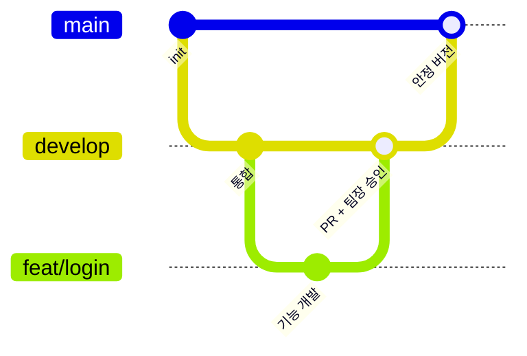

- 브랜치: `main`(안정) · `develop`(통합) · `feat/*` · `fix/*`
- 모든 작업은 **이슈 → 브랜치 → PR → 팀장 승인 → merge** 순서로 진행하고, `main`에 직접 push하지 않습니다.
- 자세한 규칙: [`.github/CONTRIBUTING.md`](.github/CONTRIBUTING.md)

---

## 자체 평가와 회고

### 팀 자체 평가

| 관점 | 점수 | 근거 |
|---|:-:|---|
| 기획 의도와의 부합 · 실무 활용 가능성 | `7 / 10` | `[팀 합의 후 기재]` |
| 달성도 · 완성도 | `8 / 10` | `[팀 합의 후 기재]` |

### 잘한 점

- 실무자 인터뷰에서 나온 핵심 기능(지표 추출·비교표)을 가장 먼저 구현했습니다.
- 근거 없음 규칙과 출처 쪽수 표시로 환각을 줄이는 구조를 만들었습니다.
- 차트 오탐을 337개에서 4개로 줄이는 등 규칙을 데이터로 검증해 정했습니다.

### 아쉬운 점과 개선 방향

- 배포 없이 로컬에서만 실행됩니다. → 배포 환경 구성
- 차트 값 복원 정확도를 더 높일 여지가 있습니다. → Vision 결과 검수 강화
- 다른 기관 보고서나 사내 문서에도 같은 구조를 적용할 수 있습니다. → 확장 과제로 정리
- 개선 목록은 GitHub Issues에 정리했습니다.

### 프로젝트를 통해 배운 것

- LangGraph로 분기·병렬·반복 흐름을 설계한 경험
- 기능 명세서·WBS·코드를 함께 맞춰 가는 협업
- 수치로 검증해야 규칙이 의미 있다는 것

---

<div align="center">

**HRI Insight Bridge** · 현대 AI 서비스 개발자 과정 1차 프로젝트 4조<br/>
류현수 · 김희진 · 서동안 · 엄정현 · 임세준 · 장유빈

</div>
